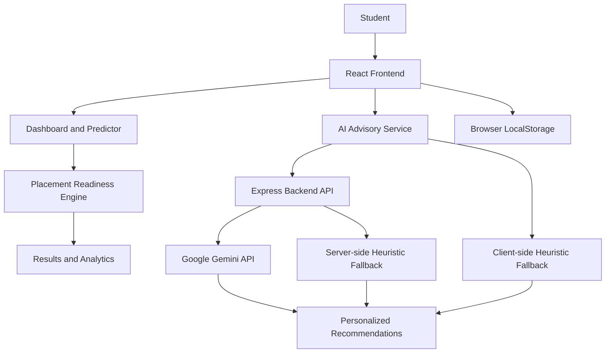

# Placeltyics
### Placement Readiness & Career Intelligence Platform

**Understand your placement readiness. Identify skill gaps. Build a smarter preparation strategy.**

Placeltyics is a full-stack web application designed to help students evaluate their placement readiness through a structured assessment of academic performance, technical skills, aptitude, communication, projects, internships and backlogs.

It combines a custom heuristic-based evaluation engine with Google Gemini-powered career guidance to turn student profile data into actionable preparation recommendations.

<p align="center">
  <a href="https://placeltyics.vercel.app/">Live Application</a> ·
  <a href="https://github.com/karthik-1806/Placeltyics">Source Code</a>
</p>

---

## Overview

Preparing for campus placements involves more than solving coding problems. Students need to understand their strengths, identify weaknesses, assess their technical preparation and prioritize the skills that matter for recruitment.

Placeltyics brings these activities together in one platform.

Students can build their academic and technical profile, calculate a placement readiness score, explore their performance through analytics and receive personalized recommendations from an AI-assisted advisory system.

## Features

### 1. Placement Readiness Predictor

Evaluate your profile using multiple dimensions:

- Academic performance and CGPA
- Data Structures and Algorithms proficiency
- Development and programming skills
- Quantitative aptitude
- Communication skills
- Internship experience and relevance
- Projects, complexity and documentation
- Active academic backlogs

The evaluation engine calculates a readiness score and provides a structured assessment of your current profile.

### 2. Interactive Dashboard

A centralized view of your placement preparation.

- Overall placement readiness
- Profile completion status
- Important preparation milestones
- Skills requiring attention
- Recommended next actions
- Previous evaluation records

### 3. AI Advisory Center

An AI-assisted career guidance system powered by the Google Gemini API.

Choose from three advisory perspectives:

**Strategic Advisor**
- Evaluates your overall placement profile.
- Identifies high-priority improvement areas.
- Suggests practical preparation milestones.

**Technical Interviewer**
- Provides technical interview preparation guidance.
- Highlights coding and project discussion areas.
- Recommends strategies for technical screening rounds.

**Academic Mentor**
- Suggests structured study routines.
- Helps prioritize academic and technical preparation.
- Provides guidance on maintaining sustainable preparation habits.

The advisory system also includes deterministic fallback recommendations when the backend or Gemini API is unavailable.

### 4. Placement Insights

Explore your profile through visual analytics.

- Multi-dimensional skill radar chart
- Historical readiness progression
- Project and internship breakdown
- Academic backlog indicators
- Skill distribution and profile analysis

### 5. Learning Resource Hub

A centralized collection of placement preparation resources.

Explore resources covering:

- Data Structures and Algorithms
- Core Computer Science subjects
- System design
- Technical interviews
- Behavioral interviews
- Resume preparation

Search and filter resources by category.

### 6. Student Profile Management

Maintain your academic and technical profile.

- Student information
- Academic details
- Career goals
- Technical competencies
- Profile completeness

### 7. Settings and Preferences

- Dark and light themes
- Profile data export in JSON format
- Profile reset controls
- Application preferences

---

## System Architecture

Placeltyics follows a modular full-stack architecture.



### Application Flow

1. Students enter their academic and technical profile.
2. The readiness engine processes the input and calculates a heuristic score.
3. The dashboard and analytics visualize the evaluation.
4. The advisory service sends the relevant profile information to the backend.
5. The backend requests structured recommendations from Google Gemini.
6. If the AI service is unavailable, fallback recommendation logic provides alternative guidance.

---

## Technology Stack

| Layer | Technologies |
|---|---|
| Frontend | React 19, TypeScript |
| Build Tool | Vite 6 |
| Styling | Tailwind CSS 4 |
| Routing | React Router |
| Data Visualization | Recharts |
| Backend | Node.js, Express.js |
| AI Integration | Google Gemini API |
| Persistence | Browser LocalStorage |
| Deployment | Vercel |

---

## Getting Started

### Prerequisites

- Node.js 20 or later recommended
- npm
- Google Gemini API key for live AI-generated recommendations

### 1. Clone the repository

```bash
git clone https://github.com/karthik-1806/Placeltyics.git

cd Placeltyics
```

### 2. Install dependencies

```bash
npm install
```

### 3. Configure environment variables

Copy the example environment file.

**Windows PowerShell:**

```powershell
Copy-Item .env.example .env
```

**macOS / Linux:**

```bash
cp .env.example .env
```

Update the `.env` file:

```env
PORT=5050
GEMINI_API_KEY=your_gemini_api_key
GEMINI_MODEL=gemini-3.8-flash
```

`GEMINI_MODEL` is optional. When omitted, the backend uses its default model.

**Security:** Never commit your `.env` file or expose the Gemini API key in frontend code.

### 4. Start the backend

Open a terminal and run:

```bash
npm run server
```

The backend starts locally on:

```text
http://localhost:5050
```

### 5. Start the frontend

Open another terminal and run:

```bash
npm run dev
```

The frontend runs on:

```text
http://localhost:3000
```

Open the local application in your browser.

### 6. Verify the production build

```bash
npx tsc --noEmit
npm run build
```

---

## API Endpoints

| Method | Endpoint | Purpose |
|---|---|---|
| GET | `/api/health` | Backend health and AI configuration status |
| POST | `/api/recommendations` | Generate personalized advisory recommendations |

The recommendations endpoint accepts student profile data, the readiness evaluation result and the selected advisory persona.

---

## Deployment

Placeltyics is deployed using Vercel.

**Live application:** https://placeltyics.vercel.app/

The repository includes `vercel.json` routing configuration for:

- Frontend application routing
- Backend API routing to the Express handler

### Production environment variables

Configure these in your Vercel project under **Settings → Environment Variables**:

| Variable | Purpose |
|---|---|
| `GEMINI_API_KEY` | Enables live Gemini API integration |
| `GEMINI_MODEL` | Optional model override; defaults to `gemini-3.8-flash` |

After changing production environment variables, trigger a new deployment.

---

## Project Structure

```text
Placeltyics/
│
├── components/
│   ├── Navbar.tsx
│   ├── PredictForm.tsx
│   ├── ResultView.tsx
│   └── ConfirmModal.tsx
│
├── pages/
│   ├── Dashboard.tsx
│   ├── PredictPage.tsx
│   ├── Coach.tsx
│   ├── Insights.tsx
│   ├── ResourceHub.tsx
│   ├── Account.tsx
│   ├── Settings.tsx
│   └── Login.tsx
│
├── services/
│   ├── predictionEngine.ts
│   └── geminiService.ts
│
├── server/
│   └── index.mjs
│
├── public/
│   ├── favicon.svg
│   └── favicon.ico
│
├── App.tsx
├── types.ts
├── constants.ts
├── index.tsx
├── index.css
├── index.html
├── package.json
├── vite.config.ts
├── tsconfig.json
├── vercel.json
└── .env.example
```

---

## Important Notes and Limitations

- **Readiness score:** The score is based on a custom heuristic evaluation engine. It is not a statistically validated probability of getting hired and does not guarantee placement.
- **Company eligibility:** Company-tier indicators are guidance based on the application's built-in rules. Actual recruitment criteria vary by employer and hiring cycle.
- **Data persistence:** Student profiles and evaluation history are stored in browser LocalStorage. They are not automatically synchronized across devices or browsers.
- **Authentication:** The current account flow is browser-based and should not be treated as production-grade server-side authentication.
- **AI recommendations:** Gemini-generated recommendations require a valid backend API configuration. Deterministic fallback recommendations remain available when the AI service is unavailable.

---

## Project Goal

Placeltyics aims to make campus placement preparation more structured and measurable by helping students understand their current capabilities, recognize improvement areas and take focused steps toward their career goals.

**Built to make placement preparation more informed, structured and actionable.**
